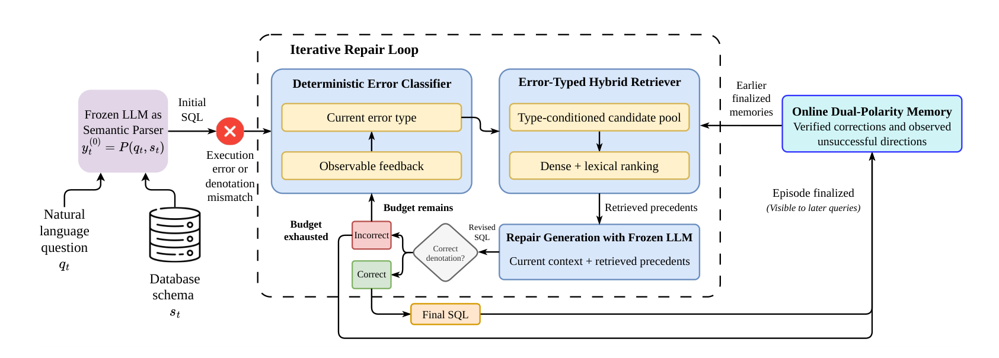
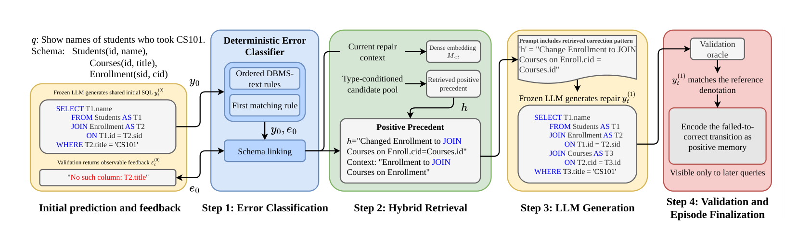

<div align="center">

<a href="https://2026.emnlp.org/"></a>
&nbsp;&nbsp;&nbsp;
<a href="https://realm-workshop.github.io/"></a>

# MERIT: Causal Episodic Memory for Feedback-Driven Agent Repair

**Khang Nhat Hoang Vo**<sup>1</sup> &nbsp; **Tam Minh Chu**<sup>2</sup> &nbsp; **Anh Trac Duc Dinh**<sup>2</sup><br>
**Thuyen Vinh Ha Bui**<sup>2</sup> &nbsp; **Tho T. Quan**<sup>2</sup>

<sup>1</sup>Mohamed bin Zayed University of Artificial Intelligence (MBZUAI), Abu Dhabi, UAE<br>
<sup>2</sup>Faculty of Computer Science and Engineering, Ho Chi Minh City University of Technology (HCMUT), VNU-HCM, Vietnam

Correspondence: [Khang.Vo@mbzuai.ac.ae](mailto:Khang.Vo@mbzuai.ac.ae), [qttho@hcmut.edu.vn](mailto:qttho@hcmut.edu.vn)

*Proceedings of the Second Workshop for REsearch on Agent Language Models (REALM 2026) at EMNLP 2026, pages 1011–1025*

[](https://aclanthology.org/2026.realm-1.70/)
[](https://aclanthology.org/2026.realm-1.70.pdf)
[](https://realm-workshop.github.io/)
[](#environment-setup)

</div>

---

## Overview

LLM agents that repair their own failures usually throw away the corrections they find, so later episodes have to rediscover similar fixes. We ask whether **finalized repair outcomes can improve later Text-to-SQL episodes without any parameter updates**.

**MERIT** (**M**emory-Augmented **E**rror-Typed **R**etrieval for **I**terative **T**ext-to-SQL repair) is a training-free agent that keeps an online **dual-polarity memory**: oracle-verified corrections are stored as positive guidance, and observed unsuccessful directions as negative guidance. Each repair step works in three parts:

1. **Classify.** A deterministic classifier maps the observed DBMS feedback to a coarse failure type.
2. **Retrieve.** The failure type conditions a hybrid lexical–dense retriever over memories from **earlier finalized episodes only**.
3. **Repair.** A frozen LLM generates one revision from the current context and the retrieved precedents.

Here, *causal* means temporal availability of memory: the current query can never see its own unfinished trajectory or the experience of future queries.

With Qwen2.5-7B-Instruct, identical initial predictions and identical repair budgets:

- On **Spider**, MERIT raises execution accuracy over stateless iterative repair from **66.34% to 69.79%** (paired 95% CI for the gain: [+1.97, +4.96]).
- On **BIRD**, it improves from **47.35% to 48.44%**, with weaker evidence (CI [0.00, +2.17]).
- MERIT is **not reliably separated from untyped dynamic retrieval** on either benchmark. Reflexion-style memory reaches 51.24% on BIRD, at substantially higher inference cost.
- Ablations show that negative memory helps only modestly, the value of type conditioning and lexical–dense ranking depends on the dataset, and **schema-local experience gives the most consistent benefit**.

<p align="center">
  
</p>
<p align="center"><em>MERIT's causal online repair process. A frozen LLM produces a shared initial SQL prediction. After an unsuccessful attempt, MERIT classifies the observed failure, retrieves experience from earlier finalized episodes and generates one revision. A benchmark correctness oracle controls termination and memory polarity without exposing the reference SQL or result rows to the model. Each finalized episode contributes at most one memory entry, visible only to later queries.</em></p>

## Method

### Causal online repair

At stream position $t$, the agent receives a question $q_t$, schema $S_t$, optional dataset evidence $a_t$, database $D_t$ and a shared initial prediction $y_t^{(0)}$. The initial prediction is generated once with greedy decoding and reused by every method, so comparisons isolate the repair strategy.

After each attempt, the benchmark evaluator returns a status (CORRECT, DENOTATION MISMATCH, EXECUTION ERROR or TIMEOUT) and the latest DBMS error, if any. The reference SQL and reference rows stay inside the evaluator and are never given to generation, classification or retrieval. With a repair budget of $K = 7$, the episode ends at the first oracle-confirmed correct revision or when the budget runs out.

A memory entry $x$ is eligible only if $\text{sourcePos}(x) < t$ and $\text{sourceQuery}(x) \neq q_t$. Four checks enforce this before every retrieval call:

1. an entry is inserted only after its source episode is finalized;
2. entries produced by the current query's own attempts are excluded, regardless of timestamp;
3. candidate pools are filtered by $\text{sourcePos}(x) < t$;
4. reference SQL, reference rows and corrected queries never appear in serialized memory or prompts.

### Deterministic failure classifier

The classifier uses only execution status and observable DBMS text. Ordered rules map errors to **RESULT MISMATCH**, **SCHEMA LINKING**, **AGGREGATION**, **FILTER/VALUE**, **EXECUTION**, **SYNTAX** or **UNKNOWN**, and the first matching rule wins. It does not inspect the SQL AST or infer semantic errors such as wrong joins. The label is recomputed after every unsuccessful revision and serves only as a retrieval prior.

### Online dual-polarity memory

Memory is split into positive and negative pools, $\mathcal{M}_{<t} = \mathcal{M}^{+}_{<t} \cup \mathcal{M}^{-}_{<t}$. An entry $x = \langle c, \tau, \Delta, o, \rho \rangle$ stores the source context, failure type, observed SQL transformation, polarity and provenance.

- A **positive** entry records the final oracle-confirmed failed-to-correct transition $y^{(k^\ast-1)}_t \to y^{(k^\ast)}_t$.
- A **negative** entry records the final direction attempted in an unresolved episode, $y^{(K-1)}_t \to y^{(K)}_t$. It only says that this direction failed in its source context.

Intermediate attempts stay local, and memory is updated only at finalization: $\mathcal{M}_{<(t+1)} = \mathcal{M}_{<t} \cup (\lbrace x_t \rbrace \setminus \lbrace \varnothing \rbrace)$.

### Error-typed hybrid retrieval

For each polarity $p$, let $L_{t,p}$ be the legal pool and $T_{t,p}$ its subset with the same predicted failure type. MERIT retrieves from $T_{t,p}$ when it holds at least three entries, and otherwise falls back to the full legal pool $L_{t,p}$. Candidates are ranked by

$$r(x, u) = 0.75\,\hat{s}_{\text{dense}}(x, u) + 0.25\,\hat{s}_{\text{BM25}}(x, u),$$

where both scores are min–max normalized within the selected pool. MERIT retrieves **at most three positive and one negative** entry per repair step.

**Type-reliability-aware variant.** A controlled variant applies hard type filtering only to SYNTAX, SCHEMA LINKING and EXECUTION, which are directly supported by DBMS diagnostics. Other types use the full legal pool with a soft type-match bonus of 0.10.

<p align="center">
  
</p>
<p align="center"><em>An example repair episode. The initial prediction references a nonexistent column, which the classifier labels as a schema-linking failure. MERIT retrieves an earlier correction involving the missing <code>Courses</code> join and uses it to generate a revision. The transition is stored as positive memory only after the oracle confirms the repaired query.</em></p>

## Experimental Setup

### Benchmarks and protocol

| Benchmark | Split | Queries | Initially correct | Official evaluator |
|---|---|---:|---:|---|
| Spider | dev | 1,034 | 609 (58.90%) | Test-suite execution |
| BIRD | dev | 1,534 | 589 (38.40%) | Execution match, pinned timeout |

A query counts as correct only when its denotation matches the evaluation target; executable but incorrect SQL does not count. Every method runs under **three stream orders** (seeds 0, 1, 2). Within a seed all methods see the same stream, and memory-based methods start from an empty store.

### Compared methods

| Method | Cross-query memory | Polarity split | Type conditioning |
|---|:---:|:---:|:---:|
| Iterative | ✗ | ✗ | ✗ |
| Reflexion-style | verbal reflections | ✗ | ✗ |
| Dynamic RAG | ✓ (same causal rule, serialization and ranking) | ✗ | ✗ |
| **MERIT** | ✓ | ✓ | ✓ |
| MERIT (type-reliability-aware) | ✓ | ✓ | soft for low-reliability types |

### Configuration

| Component | Setting |
|---|---|
| Backbone | Qwen2.5-7B-Instruct (frozen), greedy decoding, temperature 0 |
| Repair budget | 7 repair generations after the shared initial prediction |
| Dense encoder | `BAAI/bge-large-en-v1.5`, L2-normalized, FAISS `IndexFlatIP` |
| Lexical channel | Custom BM25, tokens `[a-z0-9_]+`, $k_1 = 1.5$, $b = 0.75$ |
| Ranking | $0.75\,\hat{s}_{\text{dense}} + 0.25\,\hat{s}_{\text{BM25}}$, normalized per polarity pool |
| Retrieval limits | ≤ 3 positive, ≤ 1 negative; typed threshold of 3 entries per polarity |
| Prompts | `merit-prompts-v3`, one user message, no system prompt |

## Results

### Main results

Execution accuracy (%), mean ± sample standard deviation over three stream orders. **Bold** marks the best result per dataset.

| Method | Spider | BIRD |
|---|---:|---:|
| Iterative | 66.34 ± 0.14 | 47.35 ± 0.04 |
| Reflexion-style | 68.38 ± 0.12 | **51.24** ± 0.15 |
| Dynamic RAG | **69.79** ± 0.28 | 48.15 ± 0.19 |
| **MERIT** | **69.79** ± 0.59 | 48.44 ± 0.46 |

### Paired query-level comparison

Δ is MERIT minus the comparison method, in percentage points. Intervals come from a query-cluster bootstrap that keeps each query's outcomes across all three stream orders together.

| Dataset | Comparison | Δ (pp) | 95% CI |
|---|---|---:|---|
| Spider | Iterative | **+3.45** | [+1.97, +4.96] |
| | Reflexion-style | +1.42 | [−0.19, +3.03] |
| | Dynamic RAG | 0.00 | [−1.00, +0.97] |
| | MERIT (type-rel.) | +0.39 | [−0.23, +1.03] |
| BIRD | Iterative | +1.09 | [0.00, +2.17] |
| | Reflexion-style | −2.80 | [−4.15, −1.46] |
| | Dynamic RAG | +0.28 | [−0.43, +1.00] |
| | MERIT (type-rel.) | −0.20 | [−0.67, +0.28] |

Cross-query memory clearly helps on Spider. MERIT and Dynamic RAG are not reliably separated, so the results do not establish an aggregate benefit from polarity separation and hard type conditioning over untyped dynamic retrieval. On BIRD, Reflexion-style memory is the strongest method. Hard and reliability-aware type filtering point in opposite directions on the two datasets and both intervals include zero, so neither policy is uniformly better.

### Repair behavior and inference cost

"Rep." is the number of initial failures repaired, "Steps" is repair steps per initial failure, "Osc." is the oscillation rate (%), and "Tok." is total prompt and output tokens in millions.

| Dataset | Method | Rep. ↑ | Steps ↓ | Osc. ↓ | Tok. (M) ↓ | Calls ↓ |
|---|---|---:|---:|---:|---:|---:|
| Spider | Iterative | 77.0 | 6.082 | 35.69 | **2.529** | 3,619 |
| | Reflexion-style | 98.0 | 5.821 | 32.69 | 6.597 | 6,309 |
| | Dynamic RAG | **112.7** | 5.631 | 32.20 | 5.275 | 3,427 |
| | **MERIT** | **112.7** | **5.611** | **31.95** | 5.274 | **3,419** |
| BIRD | Iterative | 137.3 | 6.238 | 54.52 | **9.325** | 7,429 |
| | Reflexion-style | **197.0** | **5.971** | **51.76** | 22.407 | 13,568 |
| | Dynamic RAG | 149.7 | 6.172 | 53.94 | 18.012 | 7,366 |
| | **MERIT** | 154.0 | 6.128 | 53.13 | 17.569 | **7,325** |

Memory mainly increases the number of initial failures that are eventually repaired. MERIT is cheaper than Reflexion-style memory, but retrieved precedents lengthen each prompt, so it uses more tokens than stateless repair.

### Ablation study

Execution accuracy (%) over three stream orders. Δ is the change from full MERIT.

| Variant | Spider | Δ | BIRD | Δ |
|---|---:|---:|---:|---:|
| **MERIT Full** | 69.79 ± 0.59 | – | 48.44 ± 0.46 | – |
| Positive only | 69.66 ± 0.53 | −0.13 | 48.35 ± 0.72 | −0.09 |
| No type filter | 69.21 ± 0.15 | −0.58 | 48.57 ± 0.49 | +0.13 |
| No dense rerank | 68.67 ± 0.29 | −1.12 | 48.57 ± 0.46 | +0.13 |
| No BM25 | **70.37** ± 0.20 | +0.58 | 48.04 ± 0.07 | −0.40 |
| Random same type | 69.70 ± 0.44 | −0.09 | 48.39 ± 0.73 | −0.05 |
| Cross-database only | 68.86 ± 0.29 | −0.93 | 45.70 ± 0.39 | **−2.74** |

- **Polarity.** Removing negative memory costs only about 0.1 points; verified corrections carry most of the useful signal.
- **Error typing.** Type conditioning helps more on Spider (−0.58 without it). On BIRD, the retrieval-policy differences are small relative to their standard deviations.
- **Lexical vs. dense.** Dense ranking matters more on Spider (−1.12 without it), while BM25 matters more on BIRD's larger, domain-specific schemas (−0.40 without it).
- **Schema locality.** Restricting retrieval to other databases gives the clearest and most consistent drop, especially on BIRD (−2.74).

<details>
<summary><b>Initial-failure composition and classifier validation</b></summary>

<br>

Shares are percentages of initial failures (425 on Spider, 945 on BIRD). "Other" aggregates Aggregation, Execution, Syntax and Unknown.

| Dataset | Result mismatch | Schema linking | Other | Acc. (%) | Macro-F1 |
|---|---:|---:|---:|---:|---:|
| Spider | 84.71 | 12.24 | 3.06 | 48.71 | 0.317 |
| BIRD | 57.99 | 33.65 | 8.36 | 48.10 | 0.355 |

The labels give useful but imperfect routing information. This is why MERIT treats error type as a coarse retrieval prior and keeps a same-polarity fallback when the typed pool is small.

</details>

<details>
<summary><b>Ordered rules of the deterministic failure classifier</b></summary>

<br>

| Observed DBMS status or text | Type | Subtype |
|---|---|---|
| `no such table:` | Schema Linking | Missing Table |
| `no such column:` | Schema Linking | Missing Column |
| `no such view:` | Schema Linking | Missing View |
| `ambiguous column name:` | Schema Linking | Ambiguous Column |
| `no such function:` | Syntax | Unknown Function |
| `syntax error`, `incomplete input` or `unrecognized token` | Syntax | Parse Failure |
| `misuse of aggregate` or `aggregate functions are not allowed` | Aggregation | DBMS Aggregate Misuse |
| `datatype mismatch` or `type mismatch` | Filter/Value | Type Mismatch |
| Attempted write under read-only execution | Execution | Read Only Violation |
| Database not found | Execution | DB Not Found |
| TIMEOUT status or text containing `timed out` | Execution | Timeout |
| Other nonempty DBMS error | Unknown | Unknown |
| Executable query with incorrect denotation | Result Mismatch | Unknown |

</details>

## Getting Started

### Repository structure

| Path | Purpose |
|---|---|
| `merit/` | Core configuration, generation, evaluation, classification, memory, retrieval, runner, metrics and export modules. |
| `configs/` | Reproducible Spider/BIRD configurations, stream-order seeds and fixed examples for the vanilla baseline. |
| `scripts/build_initial_cache.py` | Builds or validates the shared greedy initial-prediction cache. |
| `scripts/run_experiment.py` | Runs or resumes a baseline, ablation or MERIT stream. |
| `scripts/export_results.py` | Validates completed runs and exports comparison tables. |
| `scripts/reannotate_initial_cache.py` | Migrates and reannotates a supported legacy cache under the current official protocol. |
| `official_evaluation/` | Post-hoc Spider and BIRD official-evaluation wrappers and protocol documentation. |

Datasets, model weights, initial caches, run directories and generated results are not distributed in this repository.

### Supported methods

| Group | Methods | Description |
|---|---|---|
| Main method | `merit`, `merit_full` | Causal typed hybrid retrieval over positive and negative repair evidence. |
| Baselines | `zeroshot`, `iterative`, `vanilla`, `reflexion`, `dynamic_rag` | No-repair, local repair, fixed-example, reflection and untyped dynamic-retrieval controls. |
| Ablations | `positive_only`, `no_type_filter`, `confidence_aware_type_filter`, `no_dense_rerank`, `no_bm25`, `random_same_type`, `cross_database_only` | Controlled changes to memory polarity, type filtering, ranking and database scope. |
| Non-causal control | `transductive_batch` | Synchronous batch-memory control. It must not be reported as online learning. |

Two feedback regimes are implemented. `denotation_confirmed` (used in the paper) confirms correctness against the evaluation target. `dbms_only` exposes only DBMS execution feedback, so oracle correctness is not available to the online method.

### Environment setup

Python 3.11 and a CUDA-capable Linux environment are recommended. The provided GPU configurations use Qwen2.5-7B-Instruct with 4-bit NF4 quantization, BGE-large-en-v1.5 embeddings, CUDA 12.8 PyTorch and GPU FAISS.

```bash
git clone https://github.com/nhatkhangcs/merit.git
cd merit

python3.11 -m venv .venv
source .venv/bin/activate
python -m pip install --upgrade pip
python -m pip install \
  --extra-index-url https://download.pytorch.org/whl/cu128 \
  -r requirements.txt
```

The runner checks the exact package versions declared in each JSON configuration, and a reportable run stops if a required package is missing or has a different version. Model and embedding weights are loaded from Hugging Face at immutable revisions, so make sure they are reachable online or already in the local Hugging Face cache.

### Dataset preparation

Obtain [Spider](https://github.com/taoyds/spider) and [BIRD](https://bird-bench.github.io/) from their official distributions and follow their licenses. Place the files at the paths below, or point a copy of the configuration at your local paths.

| Dataset | Required paths in the supplied configuration |
|---|---|
| Spider | `data/spider/dev.json`, `data/spider/tables.json`, `data/spider_test_suite/database/` |
| BIRD | `data/BIRD/dev.json`, `data/BIRD/dev_tables.json`, `data/BIRD/dev_databases/`, and `data/BIRD/dev.sql` for post-hoc official scoring |

The loader hashes the dataset and database manifests. Existing caches and resumed runs are rejected if those identities do not match the current data.

### Official evaluator assets

Post-hoc scoring is bound to these upstream evaluator revisions:

- Spider test-suite evaluator: [`e97acc5`](https://github.com/taoyds/test-suite-sql-eval/commit/e97acc546ecbee8fa27fa8dbf025ef61493a876c)
- BIRD evaluator: [`483554e`](https://github.com/AlibabaResearch/DAMO-ConvAI/commit/483554eae102996f5ec1f4feab4e78ef29c2a394)

The wrappers expect the corresponding source and dependency bundle under `official_evaluation/vendor/`; these third-party assets are not fetched automatically. See [`official_evaluation/README.md`](official_evaluation/README.md) for the evaluation contract and commands.

## Reproducing the Paper

Run all commands from the repository root.

**1. Build or validate the shared initial cache.** If the cache does not exist, this generates one deterministic initial prediction per query; otherwise it validates the existing cache.

```bash
python scripts/build_initial_cache.py --config configs/spider.json
python scripts/build_initial_cache.py --config configs/bird.json
```

Validate the cache labels with the pinned official evaluator before launching the full matrix:

```bash
python official_evaluation/evaluate_cache.py \
  --config configs/spider.json \
  --cache cache/spider_qwen2.5-7b_official-v1.json
```

**2. Run MERIT over the three stream orders.** Swap in `configs/bird.json` for BIRD, or any method from the table above.

```bash
for seed in 0 1 2; do
  python scripts/run_experiment.py \
    --config configs/spider.json \
    --fresh-run \
    --method merit_full \
    --stream-order-seed "$seed"
done
```

Pass `--run-id <name>` for a stable run identifier when working with a scheduler.

**3. Resume an interrupted run.** Resume is strict: all configuration, source, data, model, cache, protocol and package identities must match the original run.

```bash
python scripts/run_experiment.py \
  --config configs/spider.json \
  --resume runs/spider/spider-merit-full-s0 \
  --method merit_full \
  --stream-order-seed 0
```

**4. Run post-hoc official evaluation.** The evaluator hashes run artifacts before and after scoring, writes only `official_eval.json`, and reports a mismatch if the official correct count differs from the internal one.

```bash
python official_evaluation/evaluate_run.py runs/spider/spider-merit-full-s0
```

**5. Export comparison tables.** Reportable exports require all three stream-order seeds by default.

```bash
python scripts/export_results.py \
  runs/spider/<run-directory-1> \
  runs/spider/<run-directory-2> \
  runs/spider/<run-directory-3> \
  --output-dir results/spider
```

<details>
<summary><b>Run artifacts</b></summary>

<br>

| Artifact | Contents |
|---|---|
| `config.json` | Fully resolved experiment configuration. |
| `manifest.json` | Source, data, model, package, protocol, cache and run identities. |
| `predictions.jsonl` | One final SQL prediction per query. |
| `trajectories.jsonl` | Initial and repaired SQL, outcomes, classifications and accounting per episode. |
| `retrieval_log.jsonl` | Candidate-pool sizes, retrieved memory IDs, provenance and retrieval scores. |
| `memory_positive.jsonl` / `memory_negative.jsonl` | Verified repair evidence and observed failed directions for memory-enabled methods. |
| `metrics.json` | Success@1, final accuracy, repair counts, failure breakdowns, diagnostics and resource totals. |
| `official_eval.json` | Status and results of pinned post-hoc official evaluation. |
| `stdout.log` | Human-readable episode progress. |

</details>

<details>
<summary><b>Reporting guidance</b></summary>

<br>

- Compare methods only when they share the same initial-cache identity.
- Aggregate reportable results over stream-order seeds 0, 1 and 2.
- Report the feedback regime and evaluator protocol with every result.
- Treat `transductive_batch` only as a non-causal batch control, not as online learning.
- Keep run directories: their manifests and per-query traces are part of the reproducibility record.

</details>

## Limitations

- **Oracle feedback.** MERIT assumes a denotation-level correctness signal during repair. This suits controlled benchmark evaluation but is stronger than what many deployed databases offer, where an agent may see only execution errors, partial tests or delayed user confirmation.
- **Scope.** We use one frozen backbone (Qwen2.5-7B-Instruct) and the Spider and BIRD development sets. We do not show that the same gains hold for other model families, multilingual or conversational Text-to-SQL, or production databases.
- **Order sensitivity.** Memory contents depend on query order, and three stream orders cover only part of this variation.
- **Coarse classifier.** The deterministic classifier is about 48% accurate, and RESULT MISMATCH merges several semantic errors. Retrieval weights, memory allocation and fallback policy are fixed across both benchmarks.
- **Cost.** MERIT is not cheaper than stateless repair in total tokens. Our accounting excludes embedding computation, indexing, retrieval latency and memory maintenance.

## Citation

If you find MERIT useful, please cite:

```bibtex
@inproceedings{vo-etal-2026-causal,
    title = "Causal Episodic Memory for Feedback-Driven Agent Repair",
    author = "Vo, Khang Nhat Hoang  and
      Minh, Tam  and
      Dinh, Anh Trac Duc  and
      Bui, Thuyen Vinh Ha  and
      Quan, Tho",
    editor = "Kamalloo, Ehsan  and
      Gontier, Nicolas  and
      Rozanov, Nikolai  and
      Hashemzadeh, Maryam  and
      Arora, Akhil",
    booktitle = "Proceedings of the Second Workshop for {RE}search on Agent Language Models ({REALM} 2026)",
    month = oct,
    year = "2026",
    address = "Budapest, Hungary",
    publisher = "Association for Computational Linguistics",
    url = "https://aclanthology.org/2026.realm-1.70/",
    doi = "10.18653/2026.realm-1.70",
    pages = "1011--1025",
    ISBN = "979-8-89176-485-9"
}
```

## Acknowledgements

We thank the organizers of the [REALM Workshop](https://realm-workshop.github.io/) at [EMNLP 2026](https://2026.emnlp.org/). We also acknowledge the authors and maintainers of Spider, BIRD, Qwen, BGE, and the open-source libraries and official evaluators this project builds on.

## License and Third-Party Assets

Repository license information will be added. Dataset files, model weights and official evaluator assets remain subject to their original licenses and terms of use.
